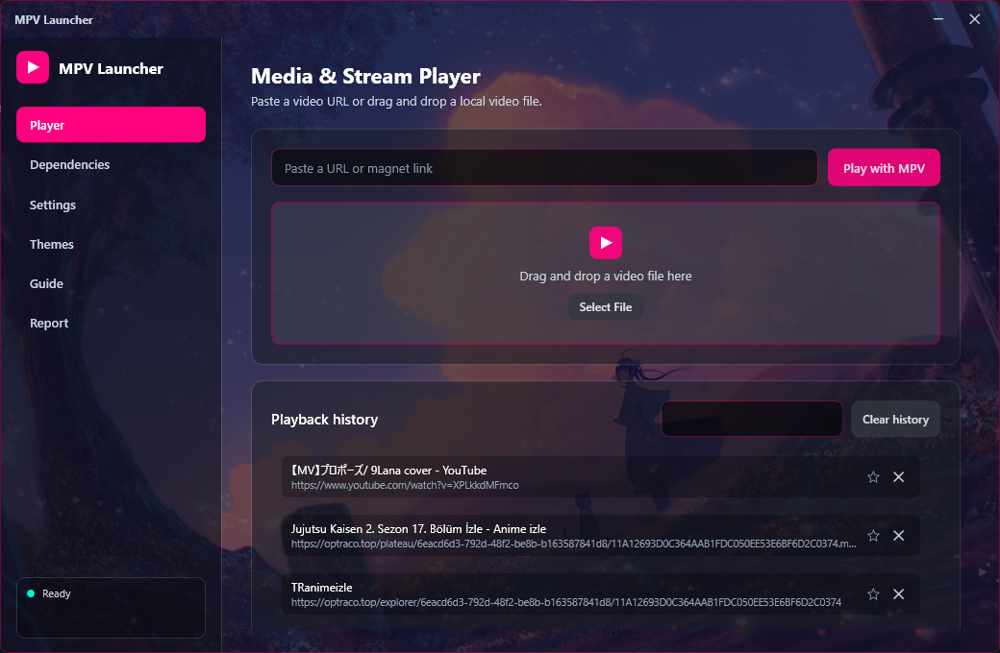
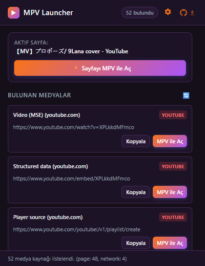

<h1 align="center">MPVLauncher</h1>

<p align="center">Tarayıcıdaki her videoyu <a href="https://mpv.io/"><b>mpv</b></a>'de tek tıkla oynatın.</p>

<p align="center">
<a href="LICENSE"></a>
<a href="https://github.com/vegasline/MPVLauncher/releases/latest"></a>
<a href="https://addons.mozilla.org/firefox/addon/mpv-launcher/"></a>
</p>

<p align="center"><a href="README.md">🌐 English</a> · Türkçe</p>

> 🤖 Bu proje yapay zekâ desteğiyle yazıldı — uygulama, eklenti, dokümantasyon ve
> testler — ve bir insan tarafından gözden geçirildi. Kodu okumaya, çalıştırmaya
> ve değiştirmeye açıktır.

---

## 📸 Nasıl görünüyor

| 🖥️ Masaüstü uygulaması — Cadılar Bayramı teması | 🧩 Tarayıcı eklentisi — Cadılar Bayramı teması |
| :---: | :---: |
|  |  |

---

## 🎬 Ne yapar

MPVLauncher, [mpv](https://mpv.io/) için küçük bir başlatıcıdır; yanında da web'deki
videoyu doğrudan oynatıcınıza gönderen bir tarayıcı eklentisi bulunur.

Normalde tarayıcıdan bir video açmak için indirme aracı, betik ya da sayfaya özel
bir yöntem gerekir. Bu proje bunu tek tıkla hâle getirir.

- 📥 **mpv'nin ihtiyacı olanları kurar** — mpv, yt-dlp ve FFmpeg'i kendi resmî
  yayınlarından. Python yok, harici çalışma zamanı yok, sisteme kurulum yok.
- 🔄 **Bu üçünü güncelleme için denetler** — tek düğme, kurulu sürümleri resmî
  sürüm sayfalarıyla karşılaştırır ve yalnızca eski olanı günceller.
- 🔌 **Eklentiyi kurar** — Chrome, Edge, Brave, Opera, Vivaldi, Yandex ve Firefox
  için; uygulama klasörü taşınırsa onarır.
- 🎬 **Gerçek akışı açar** — bir site videoyu bir oynatıcı sayfasının ya da
  iframe'in arkasına sakladığında launcher kendisi `.m3u8`'e kadar gider; mpv
  penceresinin başlığı da CDN adresi değil, tıkladığınız sayfanın başlığı olur.
- 🎨 **Temalar ve görünüm düzenleyici** — Cadılar Bayramı ve Yılbaşı dahil 7
  tema; özel renkler, bulanıklık, köşe yuvarlaklığı ve arka plan görseli.
- 💾 **Tema olarak kaydet** — düzenleyicide oluşturduğunuz görünüm
  `%APPDATA%\MPVLauncher\themes` altına tema dosyası olarak yazılır ve listede
  görünür.
- ✨ **Anime4K ve ModernZ** — anime yükseltme ve daha güzel ekran üstü kontrol.
- 🗂️ **Oynatma geçmişi** — sayfa başlıklarıyla son 50 kayıt; arama, sabitleme
  ve tek tek silme, eklentiyle paylaşılır.
- 📮 **Bildir** — önerinizi, özellik isteğinizi veya hatayı uygulamadan
  gönderin; ekran görüntüsü ekleyebilirsiniz.
- 🌍 **12 dil** uygulamada, **13 dil** eklentide.

### 🔍 Eklenti neleri bulur

- **Bağımsız iki algılama katmanı.** Bir ağ dinleyicisi sayfanın yaptığı her medya
  isteğini yakalar; bir içerik betiği henüz yüklenmemiş akışları işaretleme içinde
  arar. Sonuçlar birleştirilir, böylece tembel yüklenen bir oynatıcının arkasında
  kalan akışı kaçırmazsınız.
- **Yaygın durumlar** — HLS/m3u8, DASH, doğrudan dosyalar, `<video>` ve `<source>`,
  `object`/`embed` oynatıcıları, JSON-LD, blob ve MSE adresleri.
- **iframe'ler** — başka siteden gelen gömülü oynatıcılar listelenir; başka bir
  sayfadaki YouTube gömmesi de çalışır.
- **Filtreler** — akışları, dosyaları ve iframe'leri ayrı açıp kapatma, en küçük
  boyut belirleme, ilgilenmediğiniz sunucuları gizleme.
- **Tekrarlar birleşir** — farklı token'larla gelen aynı parça tek satırda görünür;
  `×3` rozeti kaç kopya görüldüğünü söyler.
- **Bitrate ve ölü bağlantılar** — bir HLS/DASH playlist'i en iyi varyantını
  (`1080p · 5.2 Mbps`) gösterir, 404/410 dönen adres `dead` olarak işaretlenir ve
  istenirse gizlenir.
- **Daha anlaşılır hatalar** — bir captcha veya Cloudflare doğrulaması "boş sayfa"
  yerine olduğu gibi bildirilir.

---

## 🚀 Hızlı başlangıç

1. [Son sürümden](https://github.com/vegasline/MPVLauncher/releases/latest)
   **MPVLauncher.exe** dosyasını indirin ve açın.
2. **Bağımlılıklar** sekmesine geçin ve **mpv**, **yt-dlp** ile **FFmpeg** için
   **İndir & Kur**'a tıklayın — üç ayrı düğme, üçünü de kurun. mpv oynatıcının
   kendisidir; diğer ikisi bir akış adresini açabilmesi için gereklidir. Aynı
   sekmede **Tema+anime4k Kur** düğmesi ModernZ arayüzünü ve Anime4K shader
   setini `%APPDATA%\mpv` içine kurar.
3. Yine **Bağımlılıklar** sekmesinde **Eklentileri hazırla / onar**'a tıklayarak
   tarayıcı eklentisini kurun. Aynı sekmede eklenti sayfasını açan
   **🦊 Firefox Eklentisi** ve Chromium'un ihtiyaç duyduğu klasörü açan
   **Eklenti Klasörünü Aç** düğmeleri de var.

**Yönetici hakkı gerekmez.** Her şey `%APPDATA%\MPVLauncher\` ve
`HKEY_CURRENT_USER` altına yazılır.

> ⚠️ **`MPVLauncher.exe`'yi başka bir klasöre taşıdıysanız** uygulamayı bir kez
> açmanız yeterli. Native messaging host yolunu başlangıçta kendisi onarır,
> yeniden kurulum gerekmez. **Ama tarayıcınızı sonra yeniden başlatın** —
> tarayıcı bu yolu host'u başlatırken okur; zaten açık olan tarayıcı eski yolu
> kullanmaya devam eder ve düğme hiçbir şey yapmıyormuş gibi görünür. "Dün
> çalışıyordu" demek sorunlarının çoğu bu yüzden.

> 💡 Düğme adları arayüz diline göre değişir; arayüzü Türkçe dışında bir dile
> alırsanız İngilizce görünürler.

---

## 🎮 Nasıl kullanılır

İki yol var ve ikisi de aynı mpv'de sonlanır.

**🧩 Tarayıcıdan** — herhangi bir sayfada eklenti simgesine tıklayın. Bulduğu
her şey **Open in MPV** düğmesiyle listelenir: gerçek akış, doğrudan medya
dosyaları ve gömülü oynatıcılar. Birini seçin, açılsın.

**🖥️ Programdan** — **Oynatıcı** sekmesini açın, video adresini yapıştırın ve
**MPV ile Oynat**'a basın. Dosyeyi pencereye sürükleyip bırakabilir veya
**Dosya Seç**'i kullanabilirsiniz.

Hangisini kullanırsanız kullanın, son 50 oynatma **Oynatıcı** sekmesindeki
geçmişte kalır ve iki yol arasında ortaktır.

---

### 🦊 Firefox

İmzalı eklentiyi
[addons.mozilla.org](https://addons.mozilla.org/firefox/addon/mpv-launcher/)
adresinden kurun — en kolay yol bu ve doğrudan çalışır. Firefox 140+ gerekir:
Manifest V3 ve AMO veri toplama bildirimi bu sürümden itibaren destekleniyor.

### 🌐 Chrome, Edge, Brave, Opera, Vivaldi, Yandex

> ✅ **Chromium tarafında elle yüklemek önerilen yoldur.** Tarayıcı profilinde
> bir kez yapılan paketlenmemiş yükleme yeterlidir ve tarayıcı güncellemelerinden
> sonra da çalışmaya devam eder — mağaza kaydı yok, arkanızda kendiliğinden
> güncellenen bir şey de yok. Launcher kendi tarafını hazır tutar: native
> messaging host her açılışta kaydedilir, yani elle yüklenen kopya başka bir
> düğmeye basmadan uygulamayla konuşur.

Kurulumu yaptıktan sonra `chrome://extensions` adresini açın,
**Geliştirici modu**'nu etkinleştirin, **Paketlenmemiş öğe yükle**'yi seçin ve şu
klasörü gösterin:

```
%APPDATA%\MPVLauncher\extensions\chromium
```

Uygulamadaki **Eklenti Klasörünü Aç** düğmesi bu \r
---

## 🔒 Gizlilik

Eklenti gezdiğiniz sayfalardan adres okur; bu yüzden sınırları açıkça
belirtmek gerekir:

- 🔑 **Kimlik bilgileri hiçbir zaman yakalanmaz.** `Cookie` ve `Authorization`
  daha ilk adımda elenir. Bu yüzden giriş gerektiren bir video mpv'de açılmaz —
  bu bilinçli bir tercihtir.
- 🚫 **Sayfa betiği çalıştırılmaz.** Paketlenmiş oynatıcı betikleri metin olarak
  ayrıştırılır, hiçbir zaman `eval` veya `new Function`'a verilmez.
- 🔒 **Yalnızca `http` ve `https`** oynatıcıya ulaşır ve her argüman düzgün
  alıntılanır; böylece bir adres ek mpv seçeneği sıkıştıramaz.
- 📦 **Arşiv çıkarma sınırlıdır**, indirmeler boyut sınırına tabidir ve imzalı
  medya adreslerinin erişim anahtarı günlüğe yazılmaz.
- 🔄 **Güncellemeler doğrulanır.** Yeni sürüm bu deponun yayınlarından HTTPS ile
  alınır ve yanındaki SHA-256 ile eşleşmesi durumunda kabul edilir. İndirilen
  dosya hazırlanır, yalnızca siz tıkladığınızda kurulur; ayarlarınıza, geçmişinize
  ve kurulu araçlarınıza dokunulmaz. Denetlemeyi **Ayarlar → Güncellemeler**
  altından kapatabilirsiniz.
- 📮 **Bildirim yalnızca siz Gönder'e bastığınızda gider.** Bildir sekmesi
  mesajınızı ve eklediğiniz dosyaları bir Discord webhook'una gönderir; yanında
  yalnızca launcher sürümü, arayüz dili ve işletim sistemi adı yer alır. Başka
  hiçbir bilgi okunmaz, arka planda hiçbir şey gönderilmez.

Ayrıntılar:
[`MpvLauncher.Gui/Services/NativeHostService.cs`](MpvLauncher.Gui/Services/NativeHostService.cs)

---

## ⬇️ Torrent akışı (isteğe bağlı)

Torrent akışı **varsayılan olarak kapalıdır** ve tarayıcı eklentisi üzerinden
hiçbir zaman kullanılamaz. Etkinleştirdiğinizde launcher; magnet bağlantısını,
`.torrent` dosyasını veya `.torrent` adresini küçük bir yardımcı program olan
`mpvtorrent` üzerinden oynatabilir. Yardımcı, videonun yalnızca izlenen
bölümlerini indirir ve mpv'ye `127.0.0.1` üzerinden sunar.

- 🧩 **Bir kez kurun.** **Bağımlılıklar → Torrent yardımcısı** bölümünü açıp
  **İndir ve yükle**'ye basın. Çalıştırılabilir dosya bu deponun `mpvtorrent-v*`
  sürümünden gelir, yayımlanan SHA-256 ile doğrulanır ve `%APPDATA%\MPVLauncher`
  altında tutulur.
- 🎛️ **Neyin indirileceğini siz seçin.** Çok dosyalı bir torrentte launcher
  hangi dosyanın oynatılacağını sorar ve bu seçimi torrent başına hatırlayabilir.
  Önce tüm dosyaların seçimi kaldırılır; yalnızca geçerli oynatma penceresi
  indirilir.
- ⚡ **Hızlı başlangıç.** Oynatma, dosyanın başı hazır olur olmaz başlar;
  dosyanın sonu arka planda inmeye devam eder, böylece oraya sarma başlangıcı
  beklemez. Gelişmiş bir ayar, başlamadan önce dosya sonu için en fazla 30 saniye
  bekleyebilir.
- 🚫 **Seed yok.** Yükleme varsayılan olarak kapalıdır (`0 KiB/s`) ve mpv
  kapanır kapanmaz oturum durur. Torrent arka planda asla açık bırakılmaz ve
  geçici dosyaları silinir.
- 🧹 **Her çıkışta temizlik.** mpv'yi, launcher'ı kapatmak veya süreçlerden
  birini sonlandırmak yardımcıyı durdurur ve oturum klasörünü siler; önceki bir
  çökmeden kalan klasörler bir sonraki başlatmada temizlenir.
- 🌐 **Yalnızca yerel.** HTTP akışı rastgele bir `127.0.0.1` portunda, yolda
  oturuma özel bir belirteçle dinler ve `Host` başlığını DNS yeniden
  yönlendirmesine karşı doğrular.
- ⚖️ **Sorumluluk sizde.** Torrent etkinken eşler IP adresinizi görür. Bunu
  yalnızca sahibi olduğunuz veya bulunduğunuz yerde paylaşımı yasal olan
  içerikler için kullanın.

Ayarlar **Ayarlar → Torrent akışı** altındadır: geçici klasör, hatırlanan dosya,
yardımcı kurulumu ve **Gelişmiş** grubu (ileri pencere, mpv tamponu, yükleme
sınırı, bağlantı sınırları, dosya sonu beklemesi). Gelişmiş değerler her
başlatmada güvenli varsayılanlarına döner.

---

## ⌨️ Anime4K kısayolları (mpv içinde)

| Tuş | İşlev |
| --- | --- |
| `Ctrl+0` | Anime4K'yı kapat |
| `Ctrl+1` | Mod A (hızlı) |
| `Ctrl+2` | Mod B (yüksek kalite) |
| `Ctrl+3` | Mod C (çok hızlı) |
| `Ctrl+4` | Mod A+A |
| `Ctrl+5` | Mod B+B |
| `Ctrl+6` | Mod C+A |

---

## 🛠️ Kaynaktan derleme

.NET 10 SDK'si gerekir. Node.js yalnızca eklenti testleri için.

```powershell
dotnet build MpvLauncher.Gui\MpvLauncher.Gui.csproj -c Debug
```

Eklenti çalıştırılabilir dosyanın içine gömülüdür; bu yüzden bir değişikliğin
`%APPDATA%` klasörüne ulaşması için C# projesinin yeniden derlenmesi gerekir.
Ardından uygulamada **Eklentileri hazırla / onar**'ı yeniden çalıştırın.

```powershell
node tools\extension-tests.js   # 250 kontrol - eklenti mantığı ve güvenlik
node tools\locale-tests.js      #  40 kontrol - dil dosyaları tutarlı kalır
```

---

## 🌍 Diller

**Uygulama (12):** English, Türkçe, Deutsch, Español, Bahasa Indonesia, 日本語,
한국어, Polski, Português (Brasil), Русский, Tiếng Việt, 中文 (简体)

**Eklenti (13):** aynı liste, artı Français.

---

## 🙏 Teşekkürler

- [mpv](https://mpv.io/) — bu projenin var olma sebebi olan oynatıcı
- [yt-dlp](https://github.com/yt-dlp/yt-dlp) — akış çıkarımı
- [FFmpeg](https://ffmpeg.org/) — ayrıştırma ve dönüştürme
- [Anime4K](https://github.com/bloc97/Anime4K) — gerçek zamanlı anime yükseltme
- [ModernZ](https://github.com/Samillion/ModernZ) — mpv için modern OSC
- [SharpCompress](https://github.com/adamhathcock/sharpcompress) — arşiv çıkarma
- [WebTorrent](https://github.com/webtorrent/webtorrent) — `mpvtorrent`
  içindeki torrent motoru (MIT); tüm bağımlılık lisansları
  [`tools/mpvtorrent/THIRD_PARTY_NOTICES.md`](tools/mpvtorrent/THIRD_PARTY_NOTICES.md)
  içinde
- [Node.js](https://nodejs.org/) — `mpvtorrent` çalıştırılabilir dosyasına
  gömülü çalışma zamanı

## 📄 Lisans

[MIT](LICENSE)
